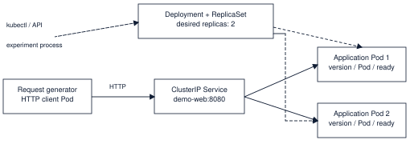

# Kubernetes Self-Healing and Rolling Updates

CISC3010 Project 11. A replicated HTTP service on kind demonstrates Pod replacement, rolling updates and CPU-based autoscaling.

[Final report](docs/final-report.pdf) · [Recorded demo](#recorded-demo) · [Results](artifacts/key-results.md)

| Path | Contents |
| --- | --- |
| `app/`, `k8s/` | HTTP application, Dockerfile and Kubernetes manifests |
| `scripts/`, `tests/` | Setup, original experiment, analysis and tests |
| `results/` | Original experiment records |
| `experiments/pressure/`, `experiments/autoscaling/` | Extension code and raw measurements |
| `artifacts/` | Tables, figures and verification logs |

## Start the components

Tested with Ubuntu 24.04 in WSL2, Docker Desktop with Linux containers and WSL integration, kind 0.33.0, Kubernetes/kubectl 1.37.0 and Python 3.12. The runs used one laptop with 16 logical CPUs and 16 GB RAM.

Start Docker Desktop. Open Ubuntu with `wsl -d Ubuntu-24.04` from PowerShell. In Ubuntu, run from the checkout:

```bash
cd /mnt/d/kubernetes-project
bash scripts/setup.sh
kubectl --context kind-selfheal -n selfheal get deployment,pods,service
```

Setup loads v1/v2 images into `kind-selfheal`, deploys two replicas and checks the Service. Run setup again if the request-generator Pod has expired.

The in-cluster client sends `GET /` to `http://demo-web:8080/`. Example response:

```json
{"version":"v1","pod":"demo-web-84fb8db64-example","ready":true}
```



## Recorded demo

**Video:** Add the recording link here or link to `demo/recording.mp4` after adding the file.

After setup, watch the Pods in a second Ubuntu terminal:

```bash
kubectl --context kind-selfheal -n selfheal get pods -l app=demo-web -w
```

In the first terminal, run one command at a time. Adjust the full script path if you cloned the repository elsewhere.

```bash
cd "$(mktemp -d /tmp/selfheal-demo.XXXXXX)"
python3 -B /mnt/d/kubernetes-project/scripts/experiment.py delete --duration 40 --action-at 5
python3 -B /mnt/d/kubernetes-project/scripts/experiment.py rollout-a --duration 40 --action-at 5
python3 -B /mnt/d/kubernetes-project/scripts/experiment.py rollout-b --duration 40 --action-at 5
```

Show the new Pod name, Ready counts, `completion_observed_s` and `failed_requests`. Each run prepares v1 before the measured action. Press Ctrl+C to stop the watch.

## Tests

Run these from the repository root. They use the Python standard library and run offline:

```bash
python3 -B -m unittest discover -s tests -v
python3 -B scripts/analyze_results.py --check
python3 -B experiments/autoscaling/analyze.py --check
```

All 9 tests passed in WSL2. The saved audit verified 27 completed runs and 652 archived files. The live deletion check observed a Ready replacement after 12.02 s with 0 failures in 400 requests. [Test log](artifacts/test-output.txt) · [Live log](artifacts/live-validation.log) · [Verification](artifacts/verification.json)

## Run the original experiments

Use a separate checkout for new measurements. Run each condition three times, reversing A/B order for the second repeat. Defaults are 80 s at 10 requests/s, with the intervention near 15 s.

```bash
python3 -B scripts/experiment.py baseline
python3 -B scripts/experiment.py delete
python3 -B scripts/experiment.py rollout-a
python3 -B scripts/experiment.py rollout-b
```

Both update strategies target 2 replicas. A uses `maxUnavailable: 0` and `maxSurge: 1`. B uses `1` and `0`. Each app Pod requests `100m CPU / 64 MiB` and has limits of `250m CPU / 128 MiB`.

## Run the pressure extension

Use the same app resources and the async client. The pilot compares one and two ready copies at 250 requests/s. Rollouts target two copies.

```bash
bash scripts/setup.sh --pressure
session=$(date -u +%Y%m%dT%H%M%SZ)
python3 -B experiments/pressure/run.py pilot --rates 250 --duration 20 --repeats 3 \
  --output "experiments/pressure/results/${session}_capacity"
python3 -B experiments/pressure/run.py rollout --rates 250 --duration 60 --repeats 3 \
  --output "experiments/pressure/results/${session}_rollout"
```

Detailed diagnostics for the saved runs:

```bash
python3 -B experiments/pressure/analyze.py --report --out "$(mktemp -d /tmp/selfheal-pressure.XXXXXX)"
```

## Optional autoscaling experiment

The separate `demo-autoscale` Deployment scales between 2 and 6 replicas. The CPU target is 60% of the CPU request and the downscale stabilization window is 60 s. Setup uses `curl` to download the pinned manifest and applies a local kind TLS patch. [Metrics Server v0.9.1](https://github.com/kubernetes-sigs/metrics-server/releases/tag/v0.9.1)

```bash
bash scripts/setup.sh --pressure
bash experiments/autoscaling/setup.sh
python3 -B experiments/autoscaling/run.py
```

The default is 3 cycles at 10, 400 and 10 requests/s for 60, 150 and 150 s respectively. [Replica counts](artifacts/autoscaling.svg) · [Autoscaling results](artifacts/autoscaling-results.json)

## Reproduce tables and figures

The [original and pressure manifest](experiments/run-manifest.json) and [autoscaling manifest](experiments/autoscaling/run-manifest.json) select the submitted runs. The analysis commands read the saved records.

```bash
python3 -m venv .venv
source .venv/bin/activate
python -m pip install "reportlab>=4.0,<5"
python -B scripts/analyze_results.py --figures
python -B experiments/autoscaling/analyze.py --figures
```

The original series recorded 0 failures in 9,600 requests. Under pressure, A recorded 370/45,000 failures and B 2,595/45,000. Some failures preceded the update. Autoscaling reached 6 Ready Pods and returned to 2 in all three cycles. [Tables and caveats](artifacts/key-results.md) · [Recovery figure](artifacts/recovery.svg) · [Pressure figure](artifacts/pressure.svg)

## Contributions

Project code covers the HTTP app, manifests, workload generators and analysis. Metrics Server is an upstream dependency. [Apache-2.0 license](https://github.com/kubernetes-sigs/metrics-server/blob/v0.9.1/LICENSE)

I used OpenAI Codex to help develop and document the project. I ran the original experiments, and Codex ran the pressure and autoscaling extensions. Raw logs, automated tests and live cluster checks were used to verify the results.
